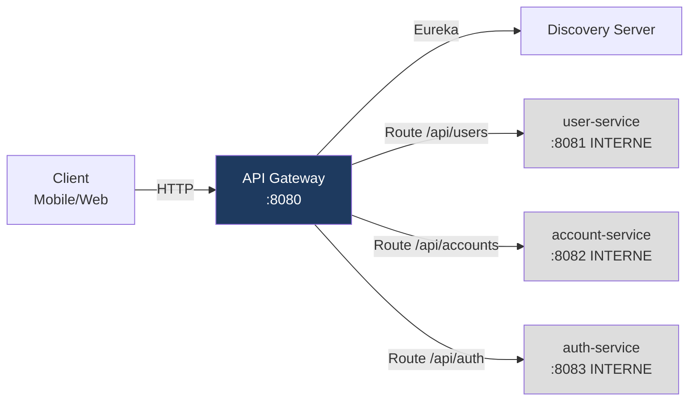

# Architecture WillBank - Sécurité des Microservices

## Principe: API Gateway comme Point d'Entrée Unique

L'architecture WillBank suit le pattern **API Gateway** où tous les microservices sont accessibles **uniquement via l'API Gateway**, jamais directement.

## Ports Exposés

### Services Accessibles Publiquement

| Service | Port | Description |
|---------|------|-------------|
| **API Gateway** | 8080 | 🔓 Point d'entrée unique pour tous les clients |
| **Discovery Server** | 8761 | 🔓 Eureka UI (pour monitoring/debug) |
| **Config Server** | 8888 | 🔓 Configuration centralisée |
| **RabbitMQ Management** | 15672 | 🔓 Interface de gestion RabbitMQ |
| **Mongo Express** | 8085 | 🔓 Interface de gestion MongoDB |

### Microservices (NON Exposés Directement)

| Service | Port Interne | Accès |
|---------|--------------|-------|
| auth-service | 8083 | 🔒 Via API Gateway uniquement |
| user-service | 8081 | 🔒 Via API Gateway uniquement |
| account-service | 8082 | 🔒 Via API Gateway uniquement |
| notification-service | 8084 | 🔒 Via API Gateway uniquement |

## Différence Docker: `ports` vs `expose`

### `ports` - Exposition Publique
```yaml
# ❌ Mauvais pour les microservices
ports:
  - "8081:8081"  # Accessible depuis l'hôte (localhost:8081)
```

### `expose` - Exposition Interne Seulement
```yaml
# ✅ Bon pour les microservices
expose:
  - "8081"  # Accessible seulement sur le réseau Docker interne
```

## Flux de Requêtes



## Exemples de Requêtes

### ✅ Correct - Via API Gateway
```http
POST http://localhost:8080/api/users/admin/customers
POST http://localhost:8080/api/auth/login
GET http://localhost:8080/api/accounts/1
```

### ❌ Incorrect - Accès Direct (Bloqué)
```http
POST http://localhost:8081/api/users/admin/customers  # Port non exposé!
POST http://localhost:8083/api/auth/login             # Port non exposé!
GET http://localhost:8082/api/accounts/1              # Port non exposé!
```

## Configuration dans `docker-compose.yml`

### API Gateway (Exposé)
```yaml
api-gateway:
  ports:
    - "8080:8080"  # Public
```

### Microservices (Non Exposés)
```yaml
user-service:
  expose:
    - "8081"  # Interne seulement
  # PAS de ports: - "8081:8081"
```

## Avantages de cette Architecture

1. **Sécurité**: Un seul point d'entrée à sécuriser
2. **Contrôle**: Toutes les requêtes passent par le Gateway
3. **Découplage**: Les microservices sont isolés
4. **Routage**: Le Gateway peut router intelligemment
5. **Authentification**: Centralisée au niveau du Gateway
6. **Rate Limiting**: Appliqué au Gateway
7. **Monitoring**: Un seul point à surveiller

## Services d'Infrastructure

Les services comme RabbitMQ Management, Mongo Express, Discovery Server restent accessibles car ce sont des **outils de monitoring/debug**, pas des services métier.

```yaml
# Outils accessibles pour administration
rabbitmq:
  ports:
    - "15672:15672"  # Management UI

mongo-express:
  ports:
    - "8085:8081"    # MongoDB UI

discovery-server:
  ports:
    - "8761:8761"    # Eureka UI
```

## Résumé

> **Règle d'Or**: Seul l'API Gateway expose des ports publics pour les services métier. Tous les microservices communiquent via le réseau interne Docker.
